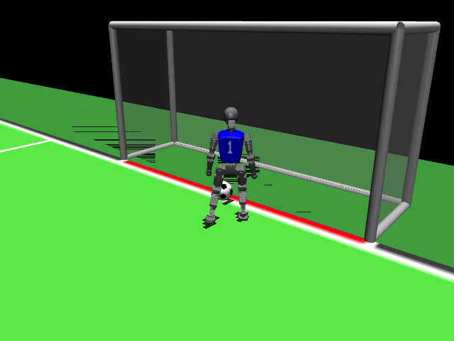

# RoboCup T1 控制与强化学习实验

面向 Booster T1 的 **23 DoF** MuJoCo 足球仿真研究，保留本人控制、训练、评估程序及可检查的实验记录。2026 年 7 月起开展，来源于个人训练工作区及 `26DigitalInfrastructure/liu-qi` 中的贡献。

## 程序结构

| 模块 | 工作 |
|---|---|
| [locomotion](locomotion/) | 关节顺序、限位、官方步态适配、RCSS 内存仿真 |
| [experiments](experiments/) | 分阶段 PPO、控球、传接球、门将及起身任务实验 |
| [v045 起身适配](experiments/v045_rcss_t1_getup_adaptation/) | 执行器契约、倒地重置、训练配置与种子评测 |
| [scripts](scripts/) | 23 DoF 审计和基础运行工具 |
| [evidence](evidence/) | 历史评测 JSON；绝对本地路径已去除 |
| [media](media/) | 自有仿真截图与视频 |

## 如何理解结果

现有 14° 和 15° 的 v045 工程抽测分别记录 16/16、8/16。对应记录明确标注 `formal_protocol: false`，它们是固定 16 场的工程检查，不是正式全协议验收，更不是实物成功率。足球完整团队战术和所有技能并未因此完成；失败实验及未通过的质量门槛同样保留。

## 复现准备

主要运行环境为 Linux/WSL、Python、MuJoCo、RCSSServerMJ、PyTorch 与 mjlab。安装对应上游环境和 T1 资产后，在仓库根目录设置 `PYTHONPATH`。先执行 `python scripts/audit_t1_23dof.py` 检查关节契约，再按各实验参数运行训练与固定种子评测。模型权重、服务器资产和完整 GPU 运行环境不随本仓库分发，因此当前公开包首先提供可审查的算法源代码和历史证据，不能直接视为无需配置的一键训练包。

上游依赖和个人贡献边界见 [SOURCES.md](SOURCES.md)。归档发布没有修改历史模型、评价结果或补造旧提交日期。
